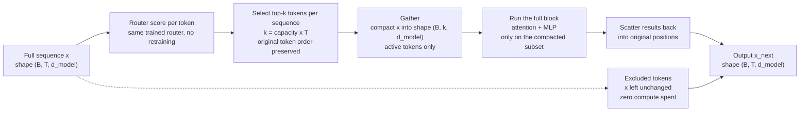

# Adaptive-Compute Transformer

### A transformer that learns where to spend its own compute, proven on real GPU hardware, not a theoretical FLOPs count.


-lightgrey)


| Metric | Value |
|---|---|
| Architecture | 12-layer transformer, built from scratch, 40.7M parameters |
| Experiments | 9 independently trained checkpoints across 3 router designs |
| Central result | Up to 27.5% real GPU latency reduction |
| Quality cost | Zero, verified to floating-point precision |

---

## Why this exists

Every production LLM call costs GPU-seconds proportional to `tokens x layers`, paid in full whether or not a given token actually needed that much computation. At serving scale, even a small reduction in average compute per token means real savings: less GPU time, lower latency, less energy. This is the same problem DeepMind's **Mixture-of-Depths** and Google's **CALM** are both working on.

This project attacks it from scratch. An original router design and training scheme, not a reimplementation of either paper, built to answer one question with real numbers instead of assumptions.

## The hypothesis

**Can a transformer learn, with no explicit per-token labels, which tokens need heavy computation and which do not? And can that be turned into less real inference cost while keeping output quality comparable?**

Two things had to hold at once for this to count as proven. Quality had to survive as the compute budget shrank. And that smaller budget had to show up as a real, measured drop in wall-clock GPU time, not just a smaller FLOPs count on paper.

## Results

### 1. Quality degrades gracefully as compute shrinks

Four independent training runs of the learned-gate router, identical except for the target average depth:

| Target avg. layers | Achieved avg. depth | Val. loss (cross-entropy) |
|---:|---:|---:|
| 2.0 | 2.647 | 3.8915 |
| 4.0 | 4.247 | 3.8423 |
| 6.0 | 6.080 | 3.8135 |
| 9.0 | 8.982 | 3.7988 |

Cutting from near-full depth (9 layers) down to a quarter of the network's total depth (2.6 layers) costs only 0.09 in cross-entropy loss. The curve is clean and monotonic: diminishing returns, exactly as the hypothesis predicts. A second, structurally different router reproduced the same shape independently, real evidence this is a property of the task, not an artifact of one router's training dynamics.

### 2. Three router designs, tested head to head

A learned, jointly-trained gate. A fixed top-k selector, the mechanism behind Mixture-of-Depths. A fixed confidence threshold, the idea behind CALM. All three trained independently, targeting the same roughly 50% compute budget:

| Router | Val. loss | Achieved budget |
|---|---:|---|
| Learned gate | **3.8135** | avg. depth 6.08 / 12 layers |
| Fixed top-k | 3.9139 | exactly 50% of tokens selected |
| Confidence threshold | 4.0682 | 25.5% of tokens selected (drifted from its 50% target during training) |

The learned gate wins outright. It is the only router whose selection mechanism adapts alongside the model during training. The confidence-threshold router drifted well off its intended budget, because nothing in its design lets it correct a threshold that was calibrated before training even started.

### 3. The quality winner cannot be hard-skipped. The runner-up can, perfectly.

The router that wins on quality is not the router that can be hard-skipped for real compute savings, and that gap is one of the project's sharpest findings.

Converting the learned gate to genuine hard-skip inference (excluding low-scoring tokens from computation entirely, not just down-weighting them) collapsed quality: validation loss rose from 3.81 to 7.26. The cause is structural, not a bug. The learned gate's trained scores are broadly distributed (mean 0.51, standard deviation 0.23), not sparse, so no cutoff exists that is safe to treat as zero.

The fixed top-k router has no such problem. Its excluded tokens were already trained with exact zero-masking, so real hard-skip inference reproduces its dense output to floating-point machine precision (measured error on the order of 10⁻⁸, or exactly zero) at every compute budget tested.

### 4. Real GPU speedup, measured at four compute budgets

A capacity sweep of the fixed top-k router, each point trained independently, benchmarked on a real Kaggle T4 GPU (32x256 batch shape, eager mode, 30 timed iterations):

| Capacity | Val. loss | Hard-skip latency | Speedup vs. dense |
|---:|---:|---:|---:|
| 0.1667 | 4.2729 | 166.5 ms | **27.5%** |
| 0.3333 | 4.0195 | 170.0 ms | **22.1%** |
| 0.5000 | 3.9139 | 186.6 ms | **17.1%** |
| 0.7500 | 3.8583 | 207.8 ms | **6.1%** |

Speedup shrinks monotonically as more compute is retained, exactly as expected. A static baseline and the router's own dense forward pass both stayed flat across all four budgets (within 3 to 5%, consistent with ordinary GPU timing noise), confirming the trend comes from the skipping mechanism itself, not measurement noise.

A FLOPs breakdown of this architecture shows the MLP sublayer, the only part hard-skip actually touches, accounts for about 70.6% of a block's compute. The honest theoretical ceiling at 50% token exclusion is therefore about 35.3% FLOPs reduction, not a naive 50%. The gap between that ceiling and the measured 17.1% speedup is documented, not hidden (see Limitations).

**This is the project's central artifact.** One router. Four independently trained checkpoints. Hard-skip proven lossless at every point. Real GPU latency measured at every point. Quality and real speed, demonstrated together, on the same model, not across two disconnected experiments.

## Architecture

### System diagram

The diagram below is wider than one screen. Scroll horizontally to see the full path from token IDs to logits, including how the router swaps in and blends with the dense block.

```mermaid
flowchart LR
    subgraph EMB["Token + Position Embedding"]
        direction TB
        TOKID["Token IDs<br/>shape (B, T)"]
        TOKEMB["Token Embedding<br/>50257 x 384<br/>tied with output head"]
        POSEMB["Position Embedding<br/>256 x 384"]
        SUM1(("add"))
        DROPOUT["Dropout, p = 0.1"]
        TOKID --> TOKEMB --> SUM1
        POSEMB --> SUM1
        SUM1 --> DROPOUT
    end

    subgraph BLOCKCORE["Dense Block: Attention + MLP"]
        direction TB
        XIN["Input x"]
        LN1["LayerNorm"]
        ATTN["Causal Self-Attention<br/>6 heads"]
        RESIDA(("add"))
        LN2["LayerNorm"]
        MLPBLK["MLP<br/>384 to 1536 to 384, GELU"]
        RESIDB(("add"))
        BLOCKOUT["block(x)"]
        XIN --> LN1 --> ATTN --> RESIDA
        XIN --> RESIDA
        RESIDA --> LN2 --> MLPBLK --> RESIDB
        RESIDA --> RESIDB
        RESIDB --> BLOCKOUT
    end

    subgraph ROUTERS["Router, one design active per run"]
        direction TB
        R1["Learned Gate<br/>sigmoid linear head<br/>trained jointly"]
        R2["Fixed Top-K<br/>exact capacity per sequence"]
        R3["Confidence Threshold<br/>relative delta norm<br/>fixed cutoff"]
    end

    subgraph BLEND["Soft Blend, training-time forward pass"]
        direction TB
        GATEVAL["gate<br/>one value per token, range 0 to 1"]
        BLENDOP["x_next = gate * block(x)<br/>+ (1 - gate) * x"]
        GATEVAL --> BLENDOP
    end

    DROPOUT --> XIN
    XIN --> R1
    XIN --> R2
    XIN --> R3
    BLOCKOUT -.->|"used only by"| R3
    R1 --> GATEVAL
    R2 --> GATEVAL
    R3 --> GATEVAL
    BLOCKOUT --> BLENDOP
    XIN --> BLENDOP

    BLENDOP --> NEXTLAYER["repeat for all 12 layers"]
    NEXTLAYER --> LNF["Final LayerNorm"]
    LNF --> HEAD["Linear Head<br/>tied with token embedding"]
    HEAD --> LOGITS["Logits<br/>shape (B, T, 50257)"]
```



**Base model.** A 12-layer decoder-only transformer: pre-LayerNorm, causal self-attention, 6 heads, `d_model=384`, `d_ff=1536`, 256-token context, dropout 0.1, tied input and output embeddings. 40.7M parameters total (21.3M excluding the tied embedding and output-head matrix, which is large relative to the model's width because of the 50,257-token GPT-2 vocabulary).

**Adaptive block.** Each layer wraps the same dense attention-plus-MLP block with a per-token router. The gate blends the block's output with its input: `x_new = gate * block(x) + (1 - gate) * x`. During training, every token still computes through every layer. The gate only scales the residual contribution, which keeps the whole system differentiable by ordinary backpropagation.

**Compute-budget loss.** A quadratic penalty pulls the batch-average effective depth toward a target. It deliberately does not penalize any single token's depth, since the entire premise is that individual tokens should be free to use very different amounts of computation.

### The three routers

| Router | Mechanism | Learned params |
|---|---|---|
| `learned_gate` | Small linear head per layer, sigmoid gate, trained jointly via the budget loss | Yes |
| `fixed_topk` | Per-sequence top-k selection by a learned score, capacity fixed exactly (e.g. 50% of tokens) | Yes (scorer only) |
| `confidence_threshold` | Gates on relative representation change against a fixed threshold, empirically calibrated offline | None |

### Real hard-skip inference

The diagram above shows the soft, dense forward pass used during training, where every token still runs through every layer. Real inference is different: excluded tokens are removed from the computation entirely, not just down-weighted.



For the fixed top-k router, this path was verified to reproduce the dense forward pass to floating-point machine precision at every compute budget tested, the property that makes the real GPU speedups above trustworthy rather than a quality-for-speed trade.

## Methodology

1. **Baseline transformer.** Standard architecture, hand-written training loop. Every run logs its full config, seed, and git commit to `experiments/<run>/config.json` before training starts.
2. **Adaptive model and learned-gate router.** Built and unit-verified (gradient checks, exact-value initialization checks, a real optimizer-step integration test proving the budget loss measurably moves model behavior) before any real training run.
3. **Accuracy-vs-depth sweep.** Four full 20,000-step training runs, only `target_avg_layers` varied, run on Kaggle and Colab GPUs.
4. **Router ablation.** Fixed top-k and confidence-threshold routers added behind a shared interface. The confidence threshold's one hyperparameter was calibrated locally, with no GPU, against the real architecture's activation statistics before spending GPU time on it.
5. **Real hard-skip inference.** Built, found to break quality on the ablation's own quality winner, root-caused to a non-sparse trained gate distribution, then pivoted to the router whose training-time behavior is structurally compatible with hard-skipping.
6. **Wall-clock benchmarking.** A real GPU latency harness comparing the static baseline, the dense adaptive model, and the hard-skip adaptive model, later extended to sweep the same compute budgets the accuracy curve was built from.
7. **Unification.** One script joins the real accuracy data and the real latency data into a single accuracy-versus-real-speed chart: the project's final deliverable.

Every Colab and Kaggle notebook in this repo materializes its code directly from the reviewed `src/*.py` files, written with `%%writefile` rather than retyped, and was verified by simulating the real target file layout locally before any GPU time was spent.

## Limitations

**The original static baseline's exact final loss is permanently lost.** A Colab runtime disconnect wiped its checkpoint and logs before they were downloaded, early in the project. Only a rendered loss-curve chart survives, so any claim of being comparable to the untouched baseline rests on an approximate, chart-read value (about 3.8), not an exact one.

**A single quoted wall-clock speedup percentage should be read as approximate.** The same nominal benchmark configuration, run in two different Kaggle GPU sessions, produced speedups of 11.3% and 17.1% at the same compute budget: real session-to-session GPU variance. The direction and existence of the speedup holds in both sessions. The exact digit is not a fixed constant.

**The gap between the 35.3% theoretical FLOPs ceiling and the observed speedup has three named, plausible causes, none confirmed with a profiler:** memory-bound gather and scatter overhead, a model too small to fully saturate the GPU on the dense matmuls it is compared against, and `torch.compile` showing no consistent benefit on this workload (and sometimes a small regression).

**No repeated-seed error bars exist anywhere in this project.** Every sweep point is a single training run. The largest gaps in each curve are well clear of a measured single-run noise floor. The smallest gaps should be read as directionally suggestive, not statistically pinned down.

**The benchmark measures prefill latency** (a full-sequence forward pass), **not autoregressive decode.** This codebase's `generate()` function has no KV-cache, which would confound any decode-time comparison.

## Repository structure

```
├── src/                        All model, training, and analysis code
│   ├── model.py                BaselineTransformer, AdaptiveTransformer, AdaptiveBlock
│   ├── router.py                LearnedGateRouter, FixedTopKRouter, ConfidenceThresholdRouter
│   ├── config.py                BaselineConfig, AdaptiveConfig (every run's resolved config)
│   ├── losses.py                Compute-budget loss
│   ├── data.py                  WikiText-103 tokenization and batching
│   ├── train.py / train_adaptive.py   Hand-written training loops
│   ├── hard_skip.py             Real hard-skip inference (mlp_only / full_block mechanisms)
│   ├── eval_hard_skip.py        Exact-reproduction verification vs. dense forward pass
│   ├── diagnose_offcapacity.py  Off-capacity inference diagnostic
│   ├── calibrate_threshold.py   Local, offline confidence-threshold calibration
│   ├── benchmark_speed.py       Real wall-clock latency harness (single and capacity-swept)
│   ├── visualize_routing.py     Token-level routing visualization generator
│   └── plot_curve.py / plot_ablation.py / plot_topk_curve.py / plot_speed_vs_accuracy.py
├── docs/                        Self-contained Colab/Kaggle notebooks (%%writefile-materialized)
├── experiments/                 Per-run config.json + train_log.jsonl + ckpt.pt
├── results/                     Generated charts and benchmark JSON
├── CLAUDE.md                    Project brief and engineering discipline
├── DECISIONS.md                 Every real engineering decision, dated, with reasoning
├── memory.md / learning.md      Full session-by-session history
└── interview-prep.md / final-interview-prep.md   Verified Q&A, including the completion audit
```

## Reproducibility

Every training run resolves its full configuration (architecture, optimizer, seed, router hyperparameters, git commit) to `experiments/<run_name>/config.json` before training starts. No result in this project is ever quoted without the exact configuration that produced it sitting next to it. All runs share seed `1337`.

To reproduce locally:
```bash
pip install -r requirements.txt
python src/train.py            # static baseline
python src/train_adaptive.py   # adaptive model (edit config.py for router_type / target_avg_layers / topk_capacity)
```

Real training ran on free-tier Colab and Kaggle T4 GPUs, using the notebooks in `docs/`, which materialize the exact reviewed source files through `%%writefile`. The code that runs on Colab or Kaggle is guaranteed identical to what is in this repository.

## Token-level routing visualization

A published, interactive visualization shows which tokens get skipped and which get fully processed, at different compute budgets, on real sentences and a real WikiText-103 validation passage.

**[View the routing visualization](https://claude.ai/code/artifact/3e0c27fb-6153-481a-8f7a-edcc62664306)**


---

## Connect with me

LinkedIn: [linkedin.com/in/saif-ibrahim-tech](https://www.linkedin.com/in/saif-ibrahim-tech/)
Email: [saifibrahim.up@gmail.com](mailto:saifibrahim.up@gmail.com)
Phone: +91 9170055886
